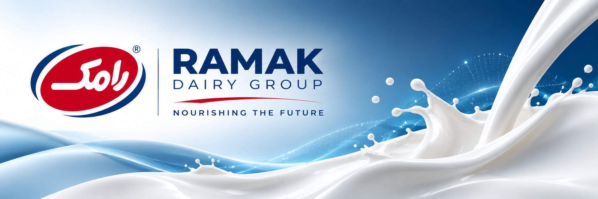

  

  

*🥛 “Ramak, a friend to young and old” 🥛*

---

## 🏭 Who we are

**Ramak Dairy Group** was founded in **1980** in **Shiraz, Fars Province** 🇮🇷,
and has grown into a national dairy brand with branches in more than
**30 cities** across Iran.

We make healthy, natural and nutritious dairy products — free from artificial
ingredients — for families of every size. 👨‍👩‍👧‍👦

| 📅 Since | 🏙️ Branches | 🏅 ISO standards | 🧺 Product families |
|:---:|:---:|:---:|:---:|
| **1980** | **30+ cities** | **4** | **5** |

## 🧀 What we make

| 🧀 Cheeses | 🥤 Drinks | 🥣 Yogurts | 🧈 Kashk, butter & cream | 🥄 Powders |
|:---:|:---:|:---:|:---:|:---:|
| White · Lighvan · Labneh Cream · Pizza · Shiraz traditional | Full-fat milk Hazelnut chocolate milk Carbonated doogh | Probiotic · Shallot Jalapeño · Sun | Shiraz local butter UHT cream · Kashk | Skimmed milk powder Whey powder |

## ✅ Certified quality

📋 Quality · 🌱 Environment · 🛡️ Food safety · 👷 Occupational health

## 💻 Software at Ramak

Built by our **Production Planning & Control (PPC)** team 📊 —

🔒 Our repositories are private.

